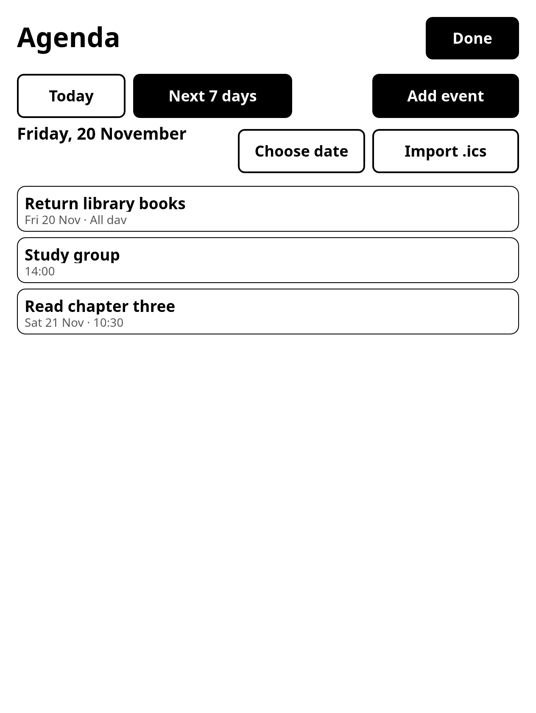
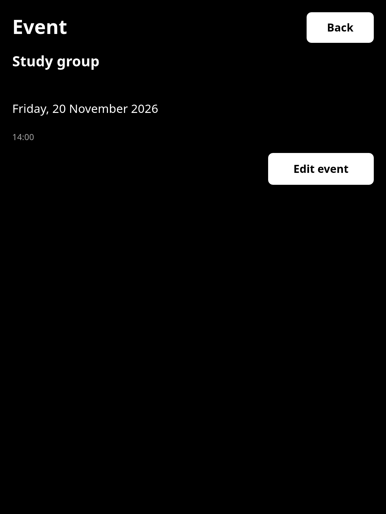
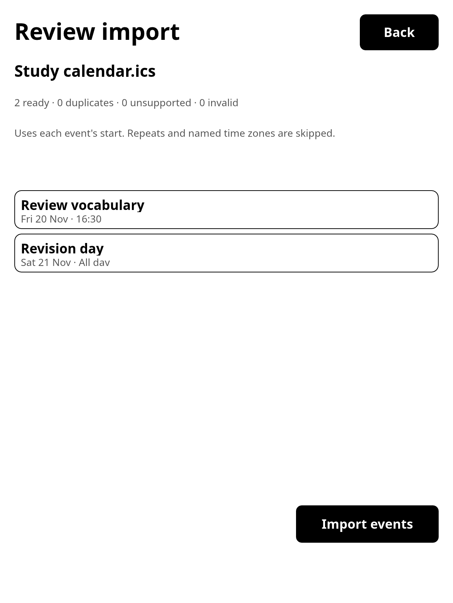

# Agenda for Kindle

A local appointment list for PrimitiveOS. See Today, the next seven days, or a date you choose.

<table>
  <tr>
    <td align="center"><br><sub>Appointments grouped by date</sub></td>
    <td align="center"><br><sub>An event in dark mode</sub></td>
    <td align="center"><br><sub>Calendar import preview</sub></td>
  </tr>
</table>

The screenshots are from the desktop simulator.

## How to use it

- Tap **Add event** and enter a title and date. Choose **All day** or enter a 24-hour time such as `0930`.
- Open an event to see its date and time or choose **Edit event**.
- Copy a UTF-8 `.ics` file into **Documents**. Tap **Import .ics**, select the file, and review the counts before importing.
- Imported appointments use their start date and time. All-day, local, and UTC starts are supported. Recurrences and named time zones are counted as unsupported. Duplicates are counted and existing events are preserved.

Agenda works offline. Import reads at most 256 KB and 128 events per file.

## Install

Open **Store** from Primitive Launcher and look for **Agenda**. [Install guide](INSTALL.md)

## Simulate on a computer

Keep [PrimitiveOS Tools](https://github.com/PrimitiveOS/kindle-primtitive-tools) and
[Primitive Launcher](https://github.com/PrimitiveOS/kindle-primitive-launcher) beside this repository.

```sh
cargo test --offline --locked --workspace
cargo run --offline --locked -p agenda-desktop -- build/previews
```

## Licence

App code is licensed under [PolyForm Noncommercial 1.0.0](LICENSE).
Original artwork, documentation, and screenshots use [CC BY-NC-SA 4.0](LICENSE-DOCS).
Chrono date handling uses the [upstream licence](licenses/chrono-LICENSE.txt).
